# FastCheck WhatsApp support integration and future Flows design

| Field | Value |
|---|---|
| Document ID | FASTCHECK-WA-FLOWS-CHATWOOT-SPEC-001 |
| Version | 0.2.3 |
| Date | 2026-11-10 |
| Status | Proposed |
| Repository baseline | main e5ec24e53d44b0cebd472c1a05f138f314bb337f, tree a54b3a1c633fe33497c396404626fb8062b1ca2b |
| Proposed location | docs/superpowers/specs/2026-11-10-whatsapp-flows-chatwoot-integration-design.md |
| MVP | FastCheck owns Meta transport; Chatwoot API Inbox handles human support |
| Deferred | WhatsApp Flows, behind a separate design and release gate |

> This proposal changes the planned support operator workspace. The October 15 support design remains the approved authority until an owner approves and records a replacement. Its implementation plan authorizes Gate 0 only. This draft does not authorize application changes.

## 1. Decision

Use a Chatwoot API Inbox as the first workspace for human support. Keep FastCheck as the only Meta webhook processor and WhatsApp sender for this integration. Keep FastCheck authoritative for inbound routing, customer identity binding, sales, checkout, payment verification, inventory, ticket issuance, resend authorization, and scanner validity.

Defer WhatsApp Flows to a separate release with its own protocol review, acceptance criteria, rollout, and approval. The support MVP uses the existing numbered-message journey. No Flow endpoint, FlowSession, Flow template, or Meta Flow configuration is part of this proposal's MVP.

Chatwoot owns the agent workspace, its assignments, and the support transcript after handoff. FastCheck owns a durable SupportHandoff routing lease and a BridgeMessage delivery ledger. FastCheck suppresses Sales routing while a handoff is active. Chatwoot never chooses a WhatsApp recipient or changes commercial state.

The API Inbox is Chatwoot's API channel. It is not Chatwoot's native WhatsApp channel. FastCheck continues to receive the Meta webhook and sends agent replies with the existing Meta client.

## 2. Change history

| Prior position | v0.2.3 proposal |
|---|---|
| Flows and Chatwoot support both appear in the first product slice. | Chatwoot API Inbox support is the MVP. Flows move to a separately gated release. |
| Claims about current state refer to an earlier repository review. | The baseline below is checked against current main and records its exact commit and tree. |
| API Inbox callback and account-webhook behavior are discussed together. | The two documented callback paths are distinguished. The pinned self-hosted release contract still needs verification. |
| The October custom inbox tasks are described as superseded after approval. | Each proposed task replacement is mapped below. The October plan remains in force until an approved plan revision records the change. |
| FlowSession and Flow endpoint details are included in the MVP architecture. | FlowSession and Flow endpoint are outside the MVP. The commercial invariants they must satisfy remain locked for the future Flow gate. |
| Help selection has no durable support-intake state before a support case is created. | Persist `collecting_support_description` on Sales.Conversation; create SupportHandoff only in the atomic transaction that accepts the first valid description. |
| Human replies are described as reusing the Sales delivery attempt and delivery policy. | BridgeMessage owns support delivery and status evidence. Reuse the Meta client and compatible outbound error classifier; add a strict support window guard without relaxing Sales delivery invariants. |
| Nonterminal handoff states do not define a complete input and routing policy. | Define input disposition for every handoff state and give the exact partial unique-index predicate for all nonterminal states. |
| v0.2.1 did not fence new agent replies from replies already admitted, and its close barrier could wait on a reply worker that required `open`. | Fence callback admission at close; let pre-fence replies follow a close-reason-specific dispatch, cancellation, or reconciliation path with a deterministic barrier. |
| v0.2.1 did not require a disposition for every inbound message held during close/recovery, or define all BridgeMessage outcomes and provider-status gaps. | Require per-message disposition before handoff termination; define both direction lifecycles, ambiguity, retries, cancellation, manual review, and status projection without fabricated receipts. |
| The current window helper accepts future timestamps, and inbound timestamp fallback can use local server time. | Require provenance-preserving Meta timestamp validation, nonnegative elapsed time, and a fresh support-window check immediately before each Meta send; leave Sales behavior unchanged. |
| v0.2.1 could map `STOP` to ordinary support exit without stating precedence over global privacy handling. | Run the existing approved STOP/privacy handler first; never forward STOP to Chatwoot or Sales while support is active. |
| v0.2.2 left the Gate D4 delivery-policy wording broad and did not name the timestamp conversion range risk or preserve the original October task authority in a ready-to-approve plan appendix. | State the exact support delivery owners, add a required `DateTime.from_unix!/1` range regression and later source-hardening task, and attach a non-authoritative task map and gated plan. The v0.2.2 architecture and lifecycle contracts remain unchanged. |

## 3. Repository baseline

### 3.1 Canonical state checked for this proposal

At review time on 2026-11-10:

- Local main and origin/main both resolve to e5ec24e53d44b0cebd472c1a05f138f314bb337f.
- The commit tree is a54b3a1c633fe33497c396404626fb8062b1ca2b.
- A read-only git ls-remote check confirmed that origin main had the same SHA.
- All implementation claims in this document refer to that exact main commit.

The source comparison was performed against the exact main commit above, not against working-tree-only edits. This proposal was prepared in a clean worktree from that verified commit.

No production configuration, secrets, customer data, Meta settings, VPS state, or installed Chatwoot instance was inspected or changed. This is a repository and public-documentation review only.

### 3.2 Current-state matrix

| Area | Verified current state on main | Boundary for this proposal |
|---|---|---|
| Meta webhook | FastCheck routes GET and POST /api/v1/webhooks/whatsapp to WhatsAppController. POST verifies X-Hub-Signature-256 over the raw body with the configured Meta app secret, filters to configured WABA and phone-number IDs, normalizes inbound messages, and processes provider delivery statuses through DeliveryStatusReconciler. | Keep this callback and its Meta ownership. Do not point Meta at Chatwoot or change Meta webhook configuration for the API Inbox MVP. |
| Inbound dedupe and checkpoint | Dedupe claims the provider message ID in Redis with SET NX and a configurable TTL that defaults to 24 hours. InboundCheckpoint writes the durable Sales.Conversation checkpoint under a Postgres advisory lock. The worker is unique on provider message ID for 24 hours, has five attempts, and stores pending reply state durably. Redis is not the conversation authority. | Route only after the existing verified, normalized, deduplicated, durable inbound handoff. A bridge must add its own durable, provider-keyed idempotency. |
| Sales conversation and Help | Sales.Conversation persists `state` and sensitive `state_data` in Postgres. The inbound worker checkpoints each message before state-machine processing. Help (`help`, main-menu 2, or active-order menu 4) returns a canned response and does not persist a state that routes the next message as a support description. The inspected source has no agent handoff lifecycle. | Add a durable `collecting_support_description` routing intent before creating a handoff. While it is set, do not send customer text to the Sales state machine. Create SupportHandoff only with the first valid description. |
| Human support | No FastCheck.Support domain, SupportCase, SupportMessage, support queue, agent reply UI, Chatwoot client, Chatwoot callback route, or Chatwoot runtime configuration was found in the application source on main. | Chatwoot integration is entirely proposed. This document does not claim production deployment or configuration. |
| Inbound timestamp and 24-hour window | InboundNormalizer parses a Unix timestamp when supplied; absent or malformed timestamps fall back to server UTC time. A syntactically valid integer is passed to `DateTime.from_unix!/1`; an integer outside its supported range can raise into the outer `normalize/2` rescue and reject the entire payload as malformed. DeliveryWindow.inside?/2 checks only `DateTime.diff(now, last_message_at, :second) <= 86_400`, so a future anchor also passes. | Do not treat the fallback as provider evidence or the current helper as a sufficient support guard. Before support release, harden per-message timestamp parsing, preserve timestamp provenance, test the supported range and overflow, and use a strict support-specific check immediately before send. Do not broaden Sales behavior here. |
| Meta outbound | FastCheck.Workers.SendWhatsAppPaymentLinkWorker and SendWhatsAppTicketLinkWorker send via FastCheck.Messaging.WhatsApp.Client. Their order-linked Sales.DeliveryAttempt records have a required `sales_order_id`; the ticket/payment DeliveryPolicy selects only existing ticket-ready or payment-link templates. OutboundDeliveryPolicy classifies rate-limit errors as safe retry, known permanent errors for manual review, and other outcomes as ambiguous/manual review. | Keep Sales.DeliveryAttempt and its order relationship unchanged. Human support replies use BridgeMessage as their delivery ledger. Reuse only compatible transport and pure error-classification functions; apply the strict support-specific window guard. |
| Delivery status | The Meta webhook currently normalizes status events and invokes DeliveryStatusReconciler, which maps WAMIDs to Sales.DeliveryAttempt rows and ignores unknown WAMIDs. | Add a support-specific reconciler for exact BridgeMessage WAMID mappings. Do not make support rows appear as Sales attempts or change the existing Sales reconciler's order invariant. |
| Event sales gate | Event.whatsapp_sales_enabled is a persisted, per-event boolean defaulting to false. Event listing and checkout enforce it. | Keep this gate for sales only. Do not treat it as a Chatwoot support flag or use support activation to enable sales. |
| Checkout and Paystack | Checkout validates the event, offer, quantity, actor scope, and WhatsApp conversation binding. It uses a durable checkout idempotency key and inventory reservation. TransactionInitialization initializes Paystack and explicitly does not verify payment, issue tickets, or mutate inventory. Payment verification is a separate server-side workflow. | Chatwoot cannot create or change orders, reservations, payment attempts, payment status, or ticket state. |
| Ticket issue and delivery | Ticket delivery uses the durable ticket delivery intent and delivery attempt path. It checks that the order is ticket_issued and the ticket issue is issued and not revoked. Ambiguous transport outcomes go to manual review. | Keep ticket links and resend behind their existing eligibility, token, and delivery contracts. No generic Chatwoot message path may bypass them. |
| Resend | Current code starts at collecting_resend_name, then collects email and verifies the existing candidate-bound OTP flow. The October 15 approved design proposes email-first OTP and one-ticket selection after verification; that change is not implemented on this main snapshot. | Preserve the approved resend security direction: email OTP is proof, phone/wa_id is correlation only, no fuzzy identity matching, and no ticket metadata or delivery before verification. |
| Chatwoot and Flows | No Chatwoot integration or WhatsApp Flow implementation was found in the application code/config/dependency paths inspected on main. | Treat all integration and Flow elements below as proposed work, not current code. |

The inspected Events and Sales sources do not expose a tenant_id or organization_id field. Do not invent a new tenant model in this integration. If another approved domain supplies tenant scope, implementation must use that existing authority.

### 3.3 October 15 authority and unresolved change

The approved design at docs/superpowers/specs/2026-10-15-whatsapp-customer-service-resend-design.md is dated 2026-10-15 and says Implementation authorization: GATE 0 ONLY. It requires a FastCheck support domain and operator inbox, plus the navigation, support routing, privacy, and resend safeguards described there.

The implementation plan at docs/superpowers/plans/2026-10-15-whatsapp-customer-service-resend.md says APPROVED FOR GATED EXECUTION and Current authorization: GATE 0 ONLY. It schedules custom support domain/routing work in Gate C and a FastCheck operator inbox in Gate D.

This proposal recommends replacing the planned commodity inbox and queue with Chatwoot. That is an architecture change against an approved document. Until the owner approves this proposal and updates the controlling implementation plan, the October 15 support design and plan remain authoritative. No implementation may start from this draft alone.

## 4. Ownership and message flow

### 4.1 Ownership matrix

| Concern | Authority | Chatwoot role | FastCheck rule |
|---|---|---|---|
| Meta webhook and WhatsApp number | Meta provider plus FastCheck integration | None | Keep FastCheck's existing webhook, app-secret verification, WABA/phone scope, and delivery-status reconciliation. |
| Inbound message identity | Meta provider message ID, scoped to the configured number | Callback message ID is a separate external reference | Use provider IDs for dedupe. Do not use message text or body hash as identity. |
| Bot versus human routing | FastCheck SupportHandoff | External status may inform a validated transition | FastCheck checks the active handoff before the Sales state machine. |
| Support episode | FastCheck Postgres SupportHandoff | Does not own FastCheck's routing lease | One nonterminal handoff per Sales.Conversation. Redis or in-memory state cannot own it. |
| Agent assignment and support workspace | Chatwoot | Owns agent assignment and its inbox workflow, subject to the verified Community Edition contract | Do not duplicate a FastCheck agent queue, claim UI, or team-management surface. |
| Support transcript after handoff | Chatwoot API Inbox | Canonical operator-visible support transcript | FastCheck stores only bridge identifiers, delivery results, and encrypted payloads needed while a message is pending or ambiguous. |
| Meta recipient | Bound FastCheck Sales.Conversation | May not supply or edit destination | Resolve the recipient from the server-side conversation and current handoff mapping. |
| WhatsApp outbound transport | FastCheck WhatsApp client; Meta transports | Agent creates content in Chatwoot, which calls FastCheck through the verified callback | Chatwoot never sends directly to Meta for this integration. |
| Payment, order, inventory, tickets, resend | FastCheck Sales, Payments, Tickets, and their approved provider boundaries | Read-only, minimized support context where approved | Chatwoot events and agent messages cannot authorize commercial effects. |
| Meta delivery status | Meta status webhook, reconciled by FastCheck | May display a derived status only if a verified update path exists | Do not equate Chatwoot's message state with Meta acceptance, delivery, or read. |

### 4.2 Webhook and outbound ownership diagram

```mermaid
flowchart LR
  C[Customer on WhatsApp] --> M[Meta Cloud API]
  M --> W[FastCheck WhatsApp webhook]
  W --> V[Raw-body signature and WABA/number scope]
  V --> I[Inbound normalize, dedupe, Postgres checkpoint, Oban]
  I --> R{FastCheck inbound router}
  R -->|Help selected| P[Postgres Sales.Conversation collecting_support_description]
  P -->|Valid text, atomic transaction| H[SupportHandoff requested and encrypted BridgeMessage]
  R -->|No support intent or handoff| S[Existing Sales conversation state machine]
  R -->|Nonterminal handoff| H
  H -->|HTTPS API| A[Chatwoot API Inbox and agent]
  A -->|Authenticated callback| X[FastCheck Chatwoot callback]
  X --> B[Validated and deduplicated BridgeMessage]
  B --> D[Support window gate and BridgeMessage ledger]
  D --> Q[Existing WhatsApp client]
  Q --> M
  M -. delivery status .-> SR[FastCheck provider-status dispatcher]
  SR -->|Exact Sales attempt mapping| SD[Existing Sales DeliveryStatusReconciler]
  SR -->|Exact support WAMID mapping| BR[SupportDeliveryStatusReconciler]
```



For the MVP, Chatwoot is not subscribed as a Meta webhook owner and does not hold the FastCheck WhatsApp access token. Chatwoot's API Inbox callback is a separate integration callback into FastCheck. `collecting_support_description` is a durable FastCheck routing intent, not a Chatwoot case or a SupportHandoff. No Chatwoot contact, conversation, or message is created before the valid description and the atomic handoff transaction.

## 5. Help intake and SupportHandoff lifecycle

### 5.1 Durable support-description collection

Help selection and support-case creation are separate transitions. The current Help action returns a canned response. It does not establish a support-description state. The proposed router first writes `Sales.Conversation.state = "collecting_support_description"` in Postgres, then asks for one short text description. This state is a FastCheck routing intent; it is not a SupportHandoff and does not create a Chatwoot contact, conversation, or message.

Enter this state on the main-menu Help option, the Help option in the active-order recovery menu, or the recognized `help` command when no SupportHandoff is active. Persist the state with a compare-and-set before returning the description prompt. Keep the existing language and every active order identifier intact. Do not clear or cancel an order to enter support. A separate global `needs_human` or `handoff_reason` is not used as the intake state.

Accept a description only when the existing InputNormalizer returns `{:ok, {:text, text}}`: trimmed, nonblank text no longer than its current 256-character limit. Numeric menu input, blank input, invalid numeric strings, non-text messages, and over-limit text are not descriptions. Re-prompt and keep `collecting_support_description`; do not create an empty handoff or route the message to Sales. The word `help` repeats the prompt.

The description body is not copied into Conversation.state_data. On valid submission it is encrypted into the initial customer-to-Chatwoot BridgeMessage in the transaction below. The existing inbound message identity, encrypted pending-reply checkpoint, Redis dedupe, and Oban retry remain in force.

### 5.2 Intake controls, duplicates, and restart

| Input while collecting the description | Required behavior |
|---|---|
| Valid `{:text, text}` | Attempt the atomic handoff transaction in §5.3. Only this input creates SupportHandoff. |
| `0` (`:back`) | Clear only the temporary support-intake state and return to the safe main menu or active-order recovery menu. Create no handoff. |
| `#` or `restart` (`:restart`) | Preserve the existing restart-to-menu behavior. Treat `#` as the hidden compatibility alias while the controlling navigation contract retains it. Create no handoff and preserve an active order. |
| `STOP` (`:stop`) | Run the existing approved global STOP/privacy handler first and preserve its exact effect. Never store or send STOP as support content. If that handler does not consume it, apply the current state-specific `:stop` and active-order guard: with no active order, cancel collection using current conversation semantics; with an active order, render order-aware recovery without mutating the order. The inspected code does not establish a separate consent opt-out record. While collection is active, do not route STOP to Sales. |
| `help` (`:help`), blank, invalid, number, unsupported message type, or over-limit text | Repeat the description prompt and keep the durable collection state. Do not invoke the Sales state machine or create a handoff. |

The collector uses the persisted Conversation state, not process memory, Redis, or ETS. After a restart, the next inbound message reloads `collecting_support_description` and resumes the prompt route. Do not expire this state into Sales by TTL. A duplicate Meta message is recognized by the existing provider-message dedupe and Conversation handled-message checkpoint; it must not prompt twice or create another BridgeMessage. The durable unique source-message key in §5.3 is the final guard if the same inbound is replayed after worker retry or process restart.

### 5.3 Atomic transition into `requested`

For a valid description, one Postgres transaction must:

1. Lock or compare-and-set the current Sales.Conversation row and confirm it is still in `collecting_support_description`.
2. Confirm the inbound Meta message ID has not already produced a handoff request and that no nonterminal handoff exists for the conversation.
3. Encrypt the description and create `SupportHandoff(state = requested)` plus its initial `BridgeMessage(direction = customer_to_chatwoot, state = queued)` bound to the configured phone-number scope and Meta message ID.
4. Move Sales.Conversation to its safe `main_menu` checkpoint, clear the temporary collection marker, and retain active-order identity and recovery fields. SupportHandoff takes routing priority after commit and until a guarded terminal transition.
5. Insert the provisioning job or durable outbox record in the same database transaction where supported. No Chatwoot HTTP call runs inside the transaction.

Use a unique source identity for `(configured phone-number scope, Meta message ID, customer_to_chatwoot)` and a compare-and-set/optimistic lock for the Conversation. If the transaction fails, leave the collection state intact and do not acknowledge that support accepted the description. If it commits and the process stops before the worker runs, restart reconciliation finds the requested handoff and queued BridgeMessage. A duplicate execution returns the existing result; it does not create a second handoff or send another Chatwoot message.

### 5.4 Handoff ownership and uniqueness

SupportHandoff is the durable routing lease for one support episode. It binds an internal handoff ID to one Sales.Conversation, the configured Chatwoot installation/account/inbox, and the verified external contact/conversation mapping. Any event context comes only from a trusted FastCheck order or conversation. It records state, close reason, an inbound high-water sequence, an agent-callback admission fence, timestamps, lock version, safe failure class, and separate Chatwoot close-operation status. It never stores a caller-editable recipient.

The exact proposed partial unique-index predicate is:

```sql
CREATE UNIQUE INDEX support_handoffs_one_nonterminal_per_conversation
ON support_handoffs (sales_conversation_id)
WHERE state IN ('requested', 'provisioning', 'open', 'closing', 'recovery_required');
```

`resolved` and `cancelled` are terminal and are excluded. `recovery_required` is explicitly included, so provisioning or callback retries cannot create a second route lease while the first outcome is unresolved. `collecting_support_description` is not a SupportHandoff; the single persisted Sales.Conversation state is its per-conversation guard.

### 5.5 Handoff states and complete input policy

Only `resolved` and `cancelled` are terminal. While a handoff is nonterminal, Sales transitions remain suppressed. Ordinary text and numeric menu input, including `help`, are support content, never Sales commands. `0` is the advertised support exit; the retained `#` and `restart` aliases follow the same guarded exit.

All inbound sequence allocation, per-message ingress persistence and routing disposition, control handling, Chatwoot callback admission, close transitions, and terminal transitions serialize against one durable per-conversation lock/version. Gate B must add a monotonic per-conversation inbound sequence and durable per-message ingress record in the ingress/checkpoint path; the current checkpoint stores only the latest message ID and does not provide either guarantee. The ingress record and sequence commit under the same lock used by close/terminal transitions. Beginning `closing` captures the greatest committed inbound sequence and fences new agent-callback admission in the same transaction. Each ordinary customer message that commits while the handoff is still nonterminal is persisted as held and advances the SupportHandoff's persisted close high-water mark. Terminalization requires every ingress record through the final high-water mark to have a durable routing/control disposition; every support-content record must also have its BridgeMessage disposition. A worker that runs late may use post-handoff bot entry only for an inbound sequence that linearizes after the terminal transition commits. For agent callbacks, the close fence decides admission: a callback committed before it is included in the barrier, and one committed after it is quarantined for reconciliation. Workers cannot decide admission from process-local state.

`STOP` is a global privacy/compliance control, not another spelling of `0`. Run the existing approved global STOP/privacy handler before support or Sales routing and preserve its exact effect. Never store STOP as a BridgeMessage or forward it to Chatwoot. If that handler starts an opt-out, its outbound suppression and retention rules govern close and held-message disposition. The inspected current ConversationStateMachine has state-specific `:stop` handling and an active-order guard but no separate persisted opt-out record; the October authority says existing global STOP/privacy behavior remains authoritative. If no approved global handler is present, preserve the existing state-specific action and fail closed: keep Sales suppressed and do not invent opt-out behavior or release an unresolved handoff.

For a nonterminal handoff, `0` or the retained `#` alias is a support-exit control, never support content. In `requested`, `provisioning`, or `open`, it atomically records `closing_reason = customer_exit`, enters `closing`, and fences new agent-callback admission. In `closing`, duplicate exit controls are idempotent and resume the same barrier. In `recovery_required`, persist the exit request but retain that state and its unique route lease until reconciliation authorizes `closing`; a control cannot clear an ambiguous external operation. Run `STOP` through the global handler first. If it does not consume STOP, apply the existing state-specific `:stop` effect as a support-local close with `closing_reason = stop`; do not call the Sales state machine. If the global handler consumes STOP, its exact recorded result governs outbound suppression and held-message disposition; retain the route lease until those effects and the handoff barrier are reconciled. Repeated STOP is idempotent. Neither control discards held customer messages or bypasses the terminal-transition guard.

| State | Customer input and persistence | Routing, transition, retry, and failure behavior |
|---|---|---|
| `requested` | The initial description is already encrypted in BridgeMessage. Later customer messages are encrypted, deduplicated by Meta message ID, assigned an ingress sequence, and queued in order. | Sales stays suppressed. A durable provisioning job advances to `provisioning`. Retry scheduling can repeat; the database source key prevents duplicate messages. No external create occurs before the job. No agent reply can be admitted before the verified Chatwoot mapping and `open` state. |
| `provisioning` | Ordinary customer messages are durably appended as queued BridgeMessages in ingress-sequence order. | Keep Sales suppressed. Verify and persist the exact Chatwoot mapping before draining. Retry only proven-safe failures. An ambiguous contact/conversation/message create or retry exhaustion moves to `recovery_required`; never repeat an uncertain create without proven read-back. Reject agent replies until the handoff is `open`. |
| `open` | Ordinary text is durably recorded as encrypted BridgeMessage before delivery to Chatwoot. Unsupported media is recorded with an explicit `unsupported` disposition and receives a safe text-only response; it is not routed to Sales. | Send customer messages to the verified Chatwoot conversation in sequence. Admit only authenticated, public agent replies bound to this handoff; persist admission and dispatch intent before callback success. Verified resolution or customer exit starts `closing` with a reason and fence. Any uncertain mapping or send moves to `recovery_required`. |
| `closing` | Any ordinary customer message that commits before terminalization is encrypted and persisted as held. It extends the close barrier and moves the handoff to `recovery_required`; it is never dropped or sent to Sales. If the terminal transition commits first, a later inbound is routed through safe post-handoff bot entry and retains its normal inbound checkpoint. | Stop normal agent-reply admission. A callback observed after the fence is durably quarantined for source-time/read-back reconciliation; it is not sent to Meta based on callback arrival alone. Replies admitted before the fence follow §6.3: continue dispatch for `agent_resolved`; cancel queued, not-yet-dispatched replies for `customer_exit`/`stop`; finish or reconcile any call already in `dispatching`. A barrier cannot complete while any held customer message, admitted agent reply, or quarantined callback lacks disposition. Chatwoot close work is separate and retryable. |
| `recovery_required` | Persist every ordinary customer message as an encrypted, deduplicated BridgeMessage in sequence with `held` disposition. | Keep Sales suppressed and alert support operations. Do not guess mappings or replay ambiguous calls. Reconcile to `open`/`provisioning` only after exact external read-back or a proven safe create/reopen path. Held messages must be delivered to the correct support episode, atomically carried into a successor handoff, or explicitly cancelled under an owner-approved privacy/exit policy. Without one of those recorded dispositions, remain here; no TTL or restart releases the route lease. |
| `resolved` / `cancelled` | A post-terminal inbound first passes through the existing global privacy/consent handler, then follows safe bot entry only if that handler permits it. A duplicate callback is a no-op. A previously unseen late Chatwoot callback is durably quarantined and alerted; it cannot enqueue a Meta send or reopen the handoff. | Terminal state. The close reconciliation must have proved the complete external message set through the close fence before this state is allowed. A customer-exit close may leave a separately tracked Chatwoot close retry, which cannot restore the old route. |

Allowed state transitions are `requested -> provisioning|closing`; `provisioning -> open|closing|recovery_required`; `open -> closing|recovery_required`; `closing -> resolved|cancelled|recovery_required`; and `recovery_required -> provisioning|open|closing|resolved|cancelled` only after explicit reconciliation. `closing_reason` is one of `agent_resolved`, `customer_exit`, or `stop`; the latter two apply the existing privacy/exit authority. All transitions compare the expected handoff ID, current state, `lock_version`, and close fence. No terminal state reopens.

The terminal-transition guard runs in one transaction under the per-conversation lock. It requires: (a) every durable inbound ingress record through the final close high-water mark has a recorded routing/control disposition, every support-content record has a corresponding customer BridgeMessage, and every such BridgeMessage has `chatwoot_accepted`, an atomic `carried_forward` reference to a successor SupportHandoff, an explicit `unsupported` disposition whose allowlisted system notice has a settled send outcome, or an explicit cancellation disposition allowed by an approved privacy/exit policy; (b) every agent reply or system notice admitted before the outbound fence is in a settled send outcome (`meta_accepted`, a reconciled provider `failed`, `blocked_outside_window`, a permitted pre-dispatch `cancelled`, or, for an agent reply only, an explicitly authorized `abandoned_unknown`), with no `callback_received`, `queued`, `dispatching`, `retry_wait`, `recovery_required`, or `manual_review` item and no quarantined callback awaiting reconciliation; (c) the external resolution is verified for `resolved`; and (d) Gate A has proved a complete Chatwoot message read-back/source-order barrier through the close event, so no pre-close public agent reply can remain hidden in callback delivery. If the pinned release cannot provide that proof, keep the handoff in `recovery_required`; do not terminalize based on callback arrival order alone. A persisted Meta acceptance with WAMID settles the send operation; later signed provider status may update its receipt projection after handoff termination and never triggers a resend. Ambiguous sends do not satisfy the guard until exact evidence resolves them or an authorized reviewer records `abandoned_unknown` for an agent reply. That disposition is terminal for automation, preserves the outcome as unknown, and never fabricates acceptance or delivery evidence. If a needed policy or external outcome is unavailable, retain `recovery_required`; do not mark terminal to clear the queue.

`carried_forward` preserves the original source identity, encrypted body, and unique BridgeMessage ID; it records the successor handoff reference and does not clone the source message. In one transaction under the conversation lock, validate the old close barrier, mark the old handoff terminal, insert the successor `requested` handoff, attach the existing held BridgeMessage to that successor while retaining its prior-handoff audit reference, transition it to `queued`, and insert the provisioning outbox. The transaction commits as one externally visible route change; satisfy the partial unique index by making the old row terminal before inserting the successor row. Do not issue an external Chatwoot call in this transaction. The customer-facing policy for cancelling held customer text on exit/STOP must be owner-approved; absent that approval, the message remains held and the handoff nonterminal. Closing one handoff never clears unrelated `needs_human` or `handoff_reason` values used for safety or commercial review.

The current Conversation transition allow-lists do not yet include `collecting_support_description`. A later implementation must add explicit guarded transitions for entry, retry, safe exit, and the atomic return to `main_menu`, or use an equally durable resource. It must not broaden existing order cancellation or restart rules. The `STOP` token observed in InputNormalizer maps to state-specific conversation cancellation in the current flow; this source review found no separate persisted consent opt-out contract. Keep any independently approved privacy/consent handler outside and ahead of support routing.

### 5.6 Routing priority

1. Verify and scope the Meta webhook; normalize and durably deduplicate it; then persist its per-message ingress record and monotonically assigned per-conversation sequence under the same durable lock used by handoff closure. Preserve timestamp provenance as specified in §6.4.
2. Load Sales.Conversation and SupportHandoff under the same durable concurrency guard used by callback admission and close transitions.
3. Run the existing approved global STOP/privacy handler first. STOP is never support content. If the handler does not consume the input, apply the current state-specific `:stop` and active-order guard. During a nonterminal handoff this remains a support-local close/control; never invoke the Sales state machine for STOP.
4. If a nonterminal SupportHandoff exists, apply its state/control policy in §5.5. Ordinary input is support content; `0`/retained `#` request guarded support exit. Do not call Sales.
5. If no handoff exists but the Conversation is `collecting_support_description`, apply §5.1–§5.3. Do not call the Sales state machine for ordinary input.
6. If no support route is active and Help is selected, persist `collecting_support_description` before returning the prompt.
7. Otherwise run the existing Sales state machine.

During intake, `1`, `2`, `3`, arbitrary text, and unsupported messages cannot start a purchase, resend, or cancellation. During a nonterminal handoff, the same inputs belong to support. Only after a guarded terminal transition may a new inbound enter safe bot navigation. Active-order lookup, identity, payment recovery, and inventory reservation remain untouched throughout.

The support rollout flag remains separate from `Event.whatsapp_sales_enabled`. If support is disabled, return an actionable safe response and do not fall through into Sales. The exact support-flag scope and disabled behavior still need owner approval.

## 6. BridgeMessage lifecycle and delivery

### 6.1 Record and identifiers

BridgeMessage is a durable delivery ledger, not a second transcript database. Keep `delivery_state` separate from the provider receipt projection so API acceptance, Meta acceptance, delivery, and read are never conflated. Its proposed metadata includes:

- internal ID and handoff ID;
- direction: customer_to_chatwoot, agent_to_whatsapp, or system_to_whatsapp;
- source system and source message ID;
- destination system and destination message ID;
- encrypted pending body, payload hash, direction-specific `delivery_state`, provider receipt projection/evidence, attempt count, retry time, lock version, and safe failure class;
- Chatwoot message ID and Meta WAMID in separate fields;
- customer ingress sequence or outbound admission ordinal, dispatch authorization time, explicit close disposition, and any successor-handoff reference;
- support-specific provider acceptance time and delivery-status projection.

Keep plaintext out of logs, telemetry, Redis keys, PubSub, and Oban arguments. Store encrypted body only while the bridge needs it for pending delivery or ambiguity resolution. Apply an approved retention and deletion policy after acceptance and reconciliation.

BridgeMessage is the complete support delivery ledger. It has no `sales_order_id` and never references a fabricated Sales order. Do not insert support replies into `Sales.DeliveryAttempt`, loosen that resource's required order relationship, or store support status evidence in the Sales delivery-status table.

### 6.2 Direction-specific BridgeMessage lifecycle

The state tables below describe delivery work. For agent-to-WhatsApp messages, `provider_status` is a separate projection that records only signed Meta evidence. A state transition must compare the expected BridgeMessage state and `lock_version`; external calls occur only after a committed dispatch intent.

| Direction | Allowed transitions and guards | Terminal meaning |
|---|---|---|
| Customer to Chatwoot | Text input starts `queued`. Unsupported media becomes terminal disposition `unsupported` with source ID/type only; do not persist or forward attachment bytes. A queued inbound moves to `held` when its handoff enters `closing` or `recovery_required`; `held -> queued` only after the exact route is reconciled or the same source row is atomically assigned to a successor handoff. `queued -> dispatching` only with the exact server-configured account/inbox and a permitted handoff mapping. Exact API acceptance plus Chatwoot message ID gives `chatwoot_accepted`. A retryable rejection returns to `retry_wait -> queued` only after Gate A proves the pinned API response means non-acceptance and retry is safe; until then, do not retry automatically. Ambiguous timeout/crash gives `recovery_required`; exact read-back may resolve it to `chatwoot_accepted`, and only proof of non-acceptance may return it to `queued` or `failed`. Conflicting/unverifiable evidence gives `manual_review`. Never retry an ambiguous create/message blindly. | `chatwoot_accepted`, proven permanent `failed`, and approved pre-dispatch `cancelled` finish delivery. `unsupported` is terminal only with its allowlisted system notice settled. `held`, `retry_wait`, `dispatching`, `recovery_required`, and `manual_review` are nonterminal. |
| Agent to WhatsApp | Authenticated, public, approved agent callback while `open` is durably admitted as `callback_received -> queued`. A permitted dispatch lease gives `dispatching`. Exact Meta acceptance plus WAMID gives `meta_accepted`; a classifier-proven rate limit gives `retry_wait -> queued`; a failed preflight gives `blocked_outside_window` without a Meta call; a known permanent rejection gives `manual_review`; an ambiguous result after possible dispatch gives `recovery_required`. A callback received after the close fence is quarantined as `recovery_required`; it cannot reach Meta unless Gate A-proven source-time/read-back reconciliation proves it was created before the fence and an authorized close policy permits it. | `meta_accepted` settles the send operation, not customer delivery. `blocked_outside_window`, reconciled `failed`, approved pre-dispatch `cancelled`, and authorized `abandoned_unknown` settle automation. `callback_received`, `queued`, `retry_wait`, `dispatching`, `recovery_required`, and `manual_review` are nonterminal. |
| System to WhatsApp | Only allowlisted, non-PII support acknowledgements (for example, “request received”) may be created from a durable handoff event with unique source key `(handoff_id, notice_type, notice_revision)`. They use `queued -> dispatching -> meta_accepted` or the same `retry_wait`, `blocked_outside_window`, `failed`, `manual_review`, and `recovery_required` outcomes as agent replies. No arbitrary customer text, Chatwoot callback, payment/ticket template, or unapproved copy can create this direction. | `meta_accepted` settles send, not delivery. `blocked_outside_window`, reconciled `failed`, and approved pre-dispatch `cancelled` settle automation. Unknown outcomes remain in `recovery_required`/`manual_review`; do not silently abandon a system notice. |
| Either outbound direction | `queued` or `callback_received` may become `cancelled` only before dispatch and with a recorded handoff/exit reason. A `dispatching` call cannot be cancelled locally; it must finish or be reconciled. `recovery_required` and `manual_review` stop automatic delivery. Exact evidence may resolve them; an authorized FastCheck reviewer under the approved `:global_ops_auth` scope may transition an irreducibly ambiguous agent reply to `abandoned_unknown`, with actor/reason audit and no delivery claim. A customer-to-Chatwoot inbound cannot be abandoned this way; it must be accepted, carried forward, or covered by an approved privacy/exit cancellation policy. | A dispatch in progress must be reconciled. Manual review is a nonterminal operational hold unless resolved through the direction-specific evidence/approval path. |

For customer-to-Chatwoot, `chatwoot_accepted`, a proven permanent `failed` outcome, and an approved pre-dispatch `cancelled` disposition finish that delivery; a failed or cancelled customer inbound still needs an allowed close-barrier disposition. `retry_wait`, `dispatching`, `recovery_required`, and `manual_review` do not. A manual-review item may move to `chatwoot_accepted` only on exact read-back, to `retry_wait`/`failed` only with proof of non-acceptance and the corresponding safe/permanent classification, or to `cancelled` under the approved exit/privacy policy. It cannot become `abandoned_unknown`.

For either outbound direction, `meta_accepted` settles the send operation and prohibits resend; it does not claim delivery. `blocked_outside_window`, proven `failed`, and approved pre-dispatch `cancelled` settle the automation outcome. The same strict window check and retry classification apply to human replies and allowlisted system notices. `recovery_required` or `manual_review` blocks handoff finalization until resolved. A manual-review item may return to `retry_wait` only with proof the provider did not accept it and a fresh in-window check; it may become `meta_accepted` only with exact response/WAMID evidence, or `abandoned_unknown` only for an agent reply by an authorized FastCheck reviewer under the approved `:global_ops_auth` scope, with actor/reason audit. `abandoned_unknown` preserves an unknown outcome and may not set `meta_accepted`, `sent`, `delivered`, or `read` without corresponding evidence.

Receipt projection begins `unknown`. Signed Meta `sent`, `delivered`, or `read` evidence may advance directly to any higher observed state; a `read` event without prior `sent`/`delivered` events sets the projection to `read` but does not create missing receipts or timestamps. Store each actual event immutably. A late lower-ranked event is retained as evidence and cannot downgrade the projection. A conflicting terminal `failed` versus `delivered`/`read` event enters `manual_review`. The currently normalized `deleted` status is observational only and cannot erase a BridgeMessage or alter its delivery projection. Duplicate events are no-ops.

### 6.3 Idempotency and ambiguous calls

Use the source provider message ID as the identity for each inbound event:

- Meta inbound: configured phone-number scope plus the Meta message ID.
- Chatwoot callback: configured installation/account/inbox, external conversation ID, and Chatwoot message ID.

Enforce a database unique constraint for each source identity and direction. Oban uniqueness is a scheduling optimization, not the durable idempotency guard. Replaying an already persisted callback returns a successful duplicate/no-op result after the original bridge record is confirmed.

The reviewed Chatwoot API documentation describes contact, conversation, and message creation but does not establish an idempotency key or duplicate-create behavior for the self-hosted release selected by this project. A timed-out create can have succeeded remotely. Gate A must prove an idempotent create or a reliable read-back/reconciliation key. If neither exists, move the BridgeMessage to recovery_required and do not repeat the create blindly.

For agent replies, use the Chatwoot message ID as the durable source event key. Admission and dispatch are separate guarded operations:

1. In one transaction, authenticate and classify the callback, require `SupportHandoff.state = open`, verify public-message and approved-agent rules, deduplicate the Chatwoot message ID, assign its admission ordinal, and persist `callback_received` plus its dispatch intent. Acknowledge the callback only after commit. A duplicate is a no-op.
2. When resolution or customer exit begins, atomically fence callback admission and store the largest admitted ordinal. A callback transaction that commits first is included in the fence. A callback delivered after the fence is not assumed to be a new post-close message: persist it in quarantine with its stable Chatwoot message ID, do not send it, and reconcile against verified Chatwoot source time/read-back behavior in Gate A.
3. A worker may atomically move an admitted `queued` reply to `dispatching` while the handoff is `open`. In `closing(reason=agent_resolved)`, it may also dispatch a reply admitted before the fence. It does not require the handoff to still be `open` after that dispatch authorization is committed.
4. In `closing(reason=customer_exit|stop)`, cancel replies already admitted but still queued and not dispatched. A reply already in `dispatching` may have reached Meta, so finish the call and reconcile it; do not claim it was cancelled. A worker that loses the state/lease race cannot call Meta.
5. Reconciliation may adopt a quarantined callback as a pre-fence reply only when the pinned Chatwoot contract and exact message read-back prove its source message was created before the close event and it is otherwise an eligible public agent reply. For `agent_resolved`, then apply the pre-fence dispatch rule. For `customer_exit|stop`, do not send it. If the source is proven post-fence, record `cancelled` with `post_close` reason and do not send it. If source ordering cannot be proven, keep the event in `recovery_required`; do not send or terminalize the handoff. Gate A must verify this capability before implementation.

Persist the BridgeMessage and dispatch authorization before the Meta call. Store support send and status evidence in the support ledger; reuse only the compatible error classifier, not the Sales attempt audit. This split prevents an already-admitted reply from being stranded when the handoff enters `closing`, while preventing post-fence callbacks from starting a send.

FastCheck-generated outage/unsupported-input notices use `system_to_whatsapp`, a separate BridgeMessage source type with a fixed allowlist of non-PII copy and source key `(handoff_id, notice_type, notice_revision)`. They do not enter the Chatwoot transcript unless a separate echo-safe mirror is approved. They use the same dispatch lease, strict support window, Meta WAMID/status reconciliation, retry, ambiguity, and close-barrier rules; they are cancelled before dispatch on customer exit/STOP when required by the controlling privacy policy. No raw customer text can be used to compose a system notice.

### 6.4 Meta sending window and provider-status reconciliation

The current `InboundNormalizer.received_at/1` converts a valid Unix timestamp but substitutes server UTC time when the Meta message timestamp is missing or malformed. That fallback is useful for checkpointing but is not proof of the Meta customer-service window. The current `DeliveryWindow.inside?/2` only checks `DateTime.diff(now, last_message_at, :second) <= 86_400`; a future-dated anchor therefore passes. Do not use either behavior alone as the support-send authorization.

For support free-form replies, persist the original signed Meta inbound timestamp and a validity/provenance marker separately from the fallback checkpoint time. The window anchor must belong to the latest customer inbound message; if that timestamp is missing, malformed, future-dated, or outside the configured phone-number/conversation scope, mark the anchor invalid rather than reusing an older timestamp or server fallback. Immediately before every outbound Meta attempt, including each retry after backoff, recompute elapsed time against that anchor using trusted UTC server time: require `0 <= elapsed < 86_400 seconds` with sufficient precision to reject even a sub-second future anchor and the exact 24-hour boundary. If that check fails, do not call Meta; set `blocked_outside_window` and expose the outcome through a verified Chatwoot path or a FastCheck operations alert. No ticket/payment template may be substituted. A separately approved support template is out of scope for this MVP.

Implement this as a support-specific strict window adapter or a separately reviewed shared-helper change with explicit Sales regression review. This document does not change `DeliveryWindow` or Sales behavior. Re-evaluate the guard immediately before each network call; an earlier allow decision is not reusable after queueing, restart, or retry.

Use `FastCheck.Messaging.WhatsApp.Client` for the provider call and the compatible pure classifier `OutboundDeliveryPolicy.classify/1`. Its current contract permits safe retry for rate-limit responses (`:rate_limited` or HTTP 429); known permanent validation, authentication, missing-configuration, and non-retryable 4xx outcomes require manual review; every other outcome is ambiguous/manual review. A process crash or timeout after dispatch with no persisted WAMID is ambiguous. Retain the BridgeMessage and do not retry that send automatically.

The signed Meta webhook continues to normalize provider statuses. A successful outbound send response stores its exact WAMID and sets `delivery_state = meta_accepted`. A support-specific `SupportDeliveryStatusReconciler` maps a verified WAMID to exactly one `agent_to_whatsapp` or `system_to_whatsapp` BridgeMessage and stores immutable status evidence under a support-owned key `(provider, channel, wamid, status, provider_status_at)`. `sent`, `delivered`, and `read` can advance the provider projection directly to the highest verified state seen; never synthesize skipped evidence. `failed` is recorded as a provider outcome and is not automatically retried. `deleted` remains observational. Duplicate evidence is a no-op; late lower-ranked evidence never downgrades the projection; conflicting terminal evidence enters `manual_review`.

If a verified support status arrives before an outbound send response has persisted the WAMID mapping, retain the scoped, body-free event as unmatched support status evidence with bounded retention. Reconcile it only after an exact outbound BridgeMessage/WAMID mapping appears. Do not guess a mapping, create a BridgeMessage from a status event, or infer acceptance from an unmatched event. If no exact mapping appears, the dispatch stays `recovery_required`; unmatched evidence expiry may alert operations but does not authorize retry or terminal success.

Status routing must preserve `DeliveryStatusReconciler` unchanged for Sales rows. Resolve a verified WAMID to its exact Sales attempt first, or to one support BridgeMessage if no Sales attempt matches. Unknown IDs are ignored. If an ID maps to both ledgers or more than one row, apply no projection and alert for manual reconciliation. A Chatwoot message ID is never used as a Meta WAMID, and Chatwoot status never substitutes for Meta status.

## 7. Callback authentication and echo prevention

### 7.1 Authentication

The Chatwoot API Inbox guide documents a callback URL, a POST when an API-channel message is created, and a generated secret for callback verification. Chatwoot's separate account-webhook guide documents X-Chatwoot-Signature, X-Chatwoot-Timestamp, and, when available, X-Chatwoot-Delivery. It describes HMAC-SHA256 over the timestamp and raw request body.

Do not assume that the API Inbox callback uses the same secret, headers, signing format, delivery ID, or retry policy as account webhooks. Gate A must test the exact callback path on the pinned self-hosted release. Until FastCheck can verify a documented cryptographic signature or another approved authenticated transport with replay controls, do not expose the callback for production use.

The FastCheck callback must:

- read and verify the raw request body before JSON parsing;
- compare signatures in constant time and enforce a configured timestamp window when the deployed contract supplies one;
- deduplicate by stable Chatwoot message ID and delivery ID when supplied;
- bind account, inbox, conversation, and message to the stored current SupportHandoff;
- reject unsupported events, malformed fields, oversized content, stale mappings, and unknown sender types;
- return success only after the callback has been durably recorded or recognized as a duplicate.

Never trust a callback-supplied phone, event ID, order ID, payment status, ticket state, or support destination.

### 7.2 Direction checks and echo prevention

The MVP accepts a Chatwoot event for WhatsApp delivery only when it is a verified public outgoing message from an approved human agent, and the event matches the active handoff and configured API Inbox. Private notes, incoming contact messages, updates, bot/system messages, and unknown sender types are not sent to Meta.

Messages FastCheck creates in Chatwoot to represent customer inbound content must not be relayed back to Meta. The exact callback representation of such API-created messages must be captured in Gate A tests. The MVP must not mirror FastCheck-originated outbound acknowledgements into Chatwoot unless a stable origin marker or message-ID reconciliation has been proven to prevent echo. A callback that cannot be classified is rejected or sent to recovery; it is never guessed to be an agent reply.

Only one application handler may act on an inbound message. A Meta delivery-status callback is handled by the existing status reconciler and cannot be routed as customer text.

## 8. Transcript ownership and privacy

Chatwoot is the operator-visible transcript for support messages created in its API Inbox after handoff. FastCheck does not copy the earlier Sales conversation into Chatwoot by default. The help description and later customer support messages are the initial transcript inputs. FastCheck-only system acknowledgements are not part of that transcript unless a separately tested, echo-safe mirror is approved.

FastCheck remains the source for Sales.Conversation state, orders, payment attempts, reservations, ticket issues, resend challenges, and scanner validity. Chatwoot may receive only the minimum safe, read-only context needed by an agent. Do not send payment authorization URLs, OTPs, ticket tokens, payment secrets, full provider payloads, or unrelated-event data.

Chatwoot will store and process plaintext that agents can see. FastCheck bridge encryption does not protect Chatwoot's own database. Before rollout, approve retention, access, export, deletion, backup, restore, incident, and South African POPIA handling for both systems. Use an opaque application contact identifier unless a reviewed operational need and privacy basis require more data.

No raw PII or message body may appear in logs, metrics, traces, worker arguments, Redis keys, or PubSub payloads. Worker arguments contain internal record IDs and non-sensitive correlation values only.

## 9. Event and tenant isolation

FastCheck binds the Chatwoot account and inbox from server-side environment configuration. A callback cannot choose its account, inbox, FastCheck conversation, event, or recipient.

Every handoff must bind to one FastCheck conversation and, when applicable, an event derived from an authoritative order or trusted conversation context. If no event is known, store no event context. Never infer event scope from a customer message, Chatwoot label, contact field, or agent-supplied text.

The inspected Events and Sales source does not define a tenant_id or organization_id. The implementation must first identify an approved tenant authority if one exists elsewhere. Until then, do not invent a tenant model or claim tenant isolation that the schema cannot enforce. Enforce the known event and Chatwoot account/inbox/conversation boundaries with server-side mappings and database constraints.

The October 15 plan scopes the V1 operator inbox to the existing dashboard and global-operations authorization. This proposal does not add event-scoped support roles or another FastCheck authentication system. Chatwoot account and inbox membership must be limited to that approved operator audience. Event isolation here means a handoff cannot be rebound to another event or expose unrelated event/order data; it does not claim per-event agent permissions. Any later event-scoped access needs an approved role mapping and a verified Chatwoot permission model.

Only include event/order context after an authorization check against FastCheck's existing domain. Support operators must not see another event's order, ticket, or payment data through a shared Chatwoot inbox. If the current role model cannot enforce this boundary, omit the context rather than broaden access.

## 10. Commercial, resend, and security invariants

The following October 15 invariants remain requirements for any later implementation:

- FastCheck remains the commercial authority. Chatwoot cannot create or cancel an order, reserve inventory, change a price, mark a payment verified, issue or revoke a ticket, or authorize a resend.
- Paystack transaction initialization and verification remain separate. A Paystack webhook or browser/Flow/Chatwoot message alone cannot mark an order paid. FastCheck verifies the transaction through its approved payment boundary before downstream ticket issuance.
- Secure payment and ticket links continue through existing recipient binding, delivery policy, durable intent/attempt, and ambiguity recovery. Do not place them in Chatwoot context.
- Email OTP is the proof for ticket resend. WhatsApp phone/wa_id may correlate or rank candidates but cannot authorize resend. Do not use fuzzy name matching for authorization. Expose ticket metadata only after OTP verification, recheck eligibility before binding, and bind exactly one ticket per resend action.
- One ticket candidate may be selected automatically only when exactly one eligible candidate exists. Multiple candidates require explicit selection within the approved bound. More than the approved bound escalates to support. Resend-all remains out of scope.
- Preserve active-order identity, status, payment recovery, and inventory reservation when a customer asks for Help, exits support, or uses a navigation control.
- While a SupportHandoff is nonterminal, ordinary text cannot execute Sales state transitions. One active handoff per conversation is enforced durably.
- Agent replies cannot select or override the WhatsApp recipient. FastCheck derives it from the bound Sales.Conversation.
- Keep the approved navigation behavior: main menu offers Buy, Help, and Resend; subflows use 0 for the safe Main menu action; # remains hidden compatibility only if retained by the controlling navigation authority; all nonterminal responses offer an action or request a clear next input.
- Keep credentials separate by provider and environment. No token, secret, phone, email, OTP, message body, or provider payload in logs or job arguments.
- Meta acceptance is not proof of delivery. Chatwoot message creation is not proof of Meta acceptance or delivery.

## 11. Chatwoot contract questions

Official documentation is useful for planning, but it does not select or certify a deployed Chatwoot Community Edition release. Resolve these questions in a disposable staging account before implementation.

| Question | What the reviewed official docs establish | What Gate A must verify |
|---|---|---|
| API Inbox setup | The API channel guide describes a callback URL, adding agents, creating a contact, using its source_id to create a conversation, and creating messages. | Exact self-hosted release, endpoints, required fields, response identifiers, public/private message behavior, and account/inbox mapping. |
| API Inbox callback authentication | The API channel guide says an automatically generated secret is available to verify callbacks. | Exact secret scope, header names, signature input, raw-body handling, rotation behavior, and whether this applies to the selected callback type. |
| Account webhooks | The general webhook guide documents message_created and conversation_status_changed events and an HMAC header/timestamp scheme. | Whether these events cover the API Inbox on the pinned release, callback ordering, retries, timeout behavior, and event payload stability. |
| Agent message classification | The docs show message_type, sender, and private fields in message/webhook examples. | Exact callback values for agent replies, private notes, API-created customer messages, bot/system messages, and unsupported content. |
| Idempotent message creation | The reviewed message endpoint documents message creation and returns a message ID. | Whether create APIs accept an idempotency key or stable external source ID, and how to read back a create after an ambiguous timeout. Do not assume either capability. |
| Token permissions | The current message API page documents a Bearer user API token for its application API and notes that this endpoint is available in Chatwoot v4.19.0 and later. | Exact release floor, service-account options, token scope/permissions, rotation, and least-privilege controls for Community Edition. Do not call the token scoped until verified. |
| Resolve and assignment lifecycle | The general webhook docs list conversation status changes. | Whether an API Inbox callback emits close, reopen, assignment, or team events; which operation is supported in Community Edition; and whether exact conversation read-back exposes a complete, stable set of public agent messages with source ordering/timestamps so a delayed callback cannot hide a pre-close reply. If it cannot, automatic terminalization is not safe. |
| Duplicate callback delivery | The account-webhook docs describe a delivery ID when available. | Whether the API Inbox callback has a stable ID, at-least-once retries, ordering guarantees, replay window, or redelivery tool. |
| Contact identity and retention | The API channel guide describes contact and contact-inbox objects. | Whether opaque identifiers work without exposing a phone number, contact dedupe behavior, deletion/export behavior, and retention in backups. |
| Edition and license | No Community Edition entitlement or license conclusion is made here. | Review the exact Community Edition license and feature matrix for inbox agents, assignments, roles, automation, retention, and required operational controls. |
| Media | The reviewed support MVP can be text-only. | Keep attachments out of MVP. Before later support, verify callback representation, storage, malware controls, size limits, retention, and privacy obligations. |
| API status semantics | Message APIs expose Chatwoot message status fields. | Prove which statuses are available for an API Inbox and never map them to Meta delivery without a verified source. |

## 12. Outage, retry, and restart recovery

### Chatwoot outage

- Commit the SupportHandoff and inbound BridgeMessage before contacting Chatwoot.
- Keep the handoff active and Sales suppressed while Chatwoot is unavailable.
- Queue safe retries with bounded backoff and a configured exhaustion policy. Exact values are a Gate A/B operating decision, not a vendor guarantee.
- Send only a safe, policy-compliant customer acknowledgement through FastCheck's existing Meta path. Do not say that an agent is assigned until Chatwoot confirms a valid conversation mapping.
- After retry exhaustion, move to recovery_required, alert the support operator, and retain the request. Do not drop the handoff or send the next customer message to Sales.
- For an ambiguous Chatwoot create, reconcile before retrying. Do not create a second contact, conversation, or message to make the local state look healthy.
- Track Chatwoot close retries separately from SupportHandoff state. A customer exit that has completed its local finalization remains cancelled if the remote close call fails; reject late replies and retry the external close operation.

### Meta outage or ambiguous send

- Keep agent replies in the durable BridgeMessage lifecycle and use the support-specific status reconciler for Meta WAMIDs.
- Use only compatible outbound error classification: rate limits may retry; ambiguous and permanent outcomes require review under §6.4.
- On ambiguous transport outcome, retain manual review and do not blindly resend a human message.
- A Meta outage cannot change order, payment, ticket, or support routing state.

### Process or Redis restart

- Postgres is the durable source for SupportHandoff and BridgeMessage. Redis, ETS, and process memory are rebuildable.
- Enqueue workers by internal IDs only. Oban uniqueness is a scheduling aid; database uniqueness and state transitions are the final idempotency guard.
- A restart reconciler scans bounded pages of nonterminal handoffs, pending BridgeMessages, and outstanding Chatwoot close operations; it requeues safe work and marks stale/ambiguous calls for reconciliation.
- Do not expire an active handoff into Sales because a TTL elapsed. Restore from durable state and preserve bot suppression until the handoff is explicitly resolved or cancelled.
- Test Chatwoot backup restore and mapping reconciliation before production. A restored Chatwoot database must not cause old callbacks to close or route a new FastCheck handoff.

## 13. Implementation gaps and minimum changes

Nothing in this section is implemented by this document.

Minimum work after approval:

1. Add a FastCheck.Support domain with SupportHandoff and BridgeMessage resources, transactional uniqueness, optimistic locking, indexes, encryption, and bounded retention.
2. Add an inbound router after the existing Meta verification, normalization, durable checkpoint, and worker claim. Assign a monotonic per-conversation ingress sequence transactionally and preserve its order through workers. It must arbitrate between support and Sales exactly once.
3. Add a Chatwoot API Inbox client and server-side mapping for contact, conversation, and message IDs after Gate A proves the endpoints and idempotency/reconciliation behavior.
4. Add a Chatwoot callback endpoint with the verified authentication scheme, replay controls, account/inbox checks, message classification, and durable duplicate handling.
5. Add bridge workers and a bounded restart reconciler. `FastCheck.Messaging.WhatsApp.Client` is the only Meta transport for support sends; BridgeMessage is the support delivery and provider-status authority. Apply a strict support-specific 24-hour guard immediately before every send attempt. Reuse only compatible classification from `OutboundDeliveryPolicy.classify/1` for safe retry versus manual review. Do not use `DeliveryPolicy`'s commercial template selection, change Sales window behavior, or create `Sales.DeliveryAttempt` rows for support replies.
6. Add the durable `collecting_support_description` Conversation transition, guarded exit/restart behavior, atomic SupportHandoff/BridgeMessage creation, and restart recovery. Do not change active-order behavior or the Sales.DeliveryAttempt invariant.
7. Configure the Chatwoot API Inbox and agent access only after Community Edition permissions and license checks. Do not build a second FastCheck operator inbox.
8. Add privacy-safe operational counters, alerts, callback/bridge runbooks, backup/restore procedures, and POPIA retention/deletion decisions.
9. Establish event isolation using trusted FastCheck records. Resolve whether an approved tenant authority exists before adding any tenant-specific mapping.
10. Verify self-hosted capacity, Postgres/Redis isolation, backup, and restore in a separately authorized deployment review. This document does not establish VPS capacity or production state.
11. Before support release, harden inbound timestamp normalization in `lib/fastcheck/messaging/whatsapp/inbound_normalizer.ex`. `DateTime.from_unix!/1` can raise for a parsed integer outside its supported range, and the outer `normalize/2` rescue can reject the whole payload. Add regression coverage in `test/fastcheck/messaging/whatsapp/inbound_normalizer_test.exs` for supported range boundaries, positive and negative out-of-range integers, malformed timestamps, and a mixed payload with a valid sibling message. The test must prove no range exception escapes per-message normalization, no invalid timestamp is treated as a trusted support-window anchor, and a malformed timestamp cannot silently become trusted server time. Carry timestamp validity/provenance separately from any checkpoint fallback. Do not change the source as part of this documentation proposal.

No FlowSession, Flow endpoint, Flow submission handler, Flow template, or Meta Flow edit belongs in these changes.

## 14. Future WhatsApp Flows gate

WhatsApp Flows remain a separate later release. A future specification and implementation plan must verify the current Meta Flow protocol, endpoint encryption, key rotation, health checks, schema limits, launch parameters, and final response shape against Meta's official documentation and a real test setup.

A Flow completion is user input, not proof of an order or payment. Any future purchase Flow must:

- bind the submission to a conversation, sender, Flow version, and expiring session;
- reject duplicate, stale, malformed, cross-conversation, or out-of-scope submissions;
- revalidate current event, offer, price, quantity, and active-order guards through FastCheck;
- invoke the existing idempotent Checkout boundary;
- initialize Paystack through the existing transaction boundary;
- wait for authoritative payment verification before ticket issuance;
- preserve the numbered-message path until in-flight Flow sessions and rollback are safe.

The Meta Developer pages for Flows could not be retrieved during this documentation pass because the site rate-limited requests. Flows are deferred, so this does not block the API Inbox MVP. Recheck the current Meta pages and protocol in the Flow gate.

## 15. October 15 task reconciliation proposal

The October 15 signed authority remains controlling. This matrix is a proposed amendment to review at Gate 0; it does not change task status or authorization. The Gate A/B names in the October plan continue to mean navigation and resend. The proposed Chatwoot gates in the plan appendix use the `Support Gate` prefix to avoid name collisions.

| October 15 task | Current authority before owner approval | Proposed disposition only after signed approval |
|---|---|---|
| Gate 0, Task 0.1: reconstruct approved spec and plan | Retain. Current approved files and Gate 0-only authorization remain authoritative. | Add a signed v0.2.3 architecture decision and the approved plan amendment; retain the October 15 documents as history and do not overwrite their approved bytes. |
| Gate A, Tasks A1-A2: navigation and contextual `0` | Retain unchanged. | No supersession. Support routes must preserve the approved menu, escape, and active-order behavior. |
| Gate B, Tasks B1-B6: email-first resend and one-ticket selection | Retain unchanged. | No supersession. Chatwoot cannot change resend proof, candidate binding, OTP, or ticket delivery authority. |
| Gate C, Task C1: `SupportCase` and `SupportMessage` resources | Approved work remains planned; not replaced yet. | Replace the record pair with `SupportHandoff` and `BridgeMessage`. Keep durable uniqueness, locking, audit, encryption, and retention requirements. |
| Gate C, Task C2: encrypt `SupportMessage` bodies | Approved work remains planned; not replaced yet. | Retain encryption only for pending or ambiguous bridge payloads. Do not create a full FastCheck support transcript. Delete ciphertext only under an approved retention rule after reconciliation. |
| Gate C, Task C3: support request and bot-suppression routing | Approved work remains planned; not replaced yet. | Retain and revise for durable `collecting_support_description`, atomic handoff creation, per-message ingress order, exclusive bot/human routing, and the v0.2.2 close barrier. Preserve active-order and unrelated review guards. |
| Gate C, Task C4: hot/warm queue mirrors and PubSub | Approved work remains planned; not replaced yet. | Supersede operator waiting/claimed queue mirrors and queue PubSub with Chatwoot assignment, only where Gate A verifies those capabilities. Keep Postgres routing authority, bounded Oban work, and required operational alerts; Redis/ETS never own handoff state. |
| Gate D, Task D1: FastCheck LiveView support inbox and routes | Approved work remains planned; not replaced yet. | Supersede the agent inbox UI with a configured Chatwoot API Inbox after release, license, authentication, access, and retention checks. Keep a machine callback route in FastCheck with Gate A-verified authentication and replay controls. |
| Gate D, Task D2: custom inbox, queue, and claim | Approved work remains planned; not replaced yet. | Supersede custom operator queue and claim actions with verified Chatwoot workflow. FastCheck retains handoff identity, routing lease, and state-transition guards, not agent assignment. |
| Gate D, Task D3: decrypted FastCheck case history | Approved work remains planned; not replaced yet. | Supersede the custom history UI. Chatwoot owns the operator transcript; FastCheck decrypts only bridge payloads needed for pending delivery or ambiguity recovery. |
| Gate D, Task D4: `SupportOutboundWorker` from LiveView | Approved work remains planned; not replaced yet. | Replace with the Chatwoot callback-to-BridgeMessage path. `FastCheck.Messaging.WhatsApp.Client` sends to Meta; BridgeMessage owns support delivery and status evidence; apply the strict support-specific 24-hour guard before every attempt; reuse only compatible `OutboundDeliveryPolicy.classify/1` error classification. Never use `DeliveryPolicy` templates or `Sales.DeliveryAttempt` for support replies. |
| Gate D, Task D5: custom resolve/cancel UI and operations | Approved work remains planned; not replaced yet. | Supersede custom resolution UI with a verified Chatwoot lifecycle callback/read-back and guarded FastCheck close operation. Retain held-message disposition, unrelated manual-review protection, failure recovery, privacy policy, and runbooks. |
| Gate E, Task E1: supported sandbox fixture | Retain. | Keep the existing fixture authority. Extend only through supported app paths for isolated Chatwoot certification; no ad hoc SQL or production customer data. |
| Gate E, Task E2: certification runbook and evidence matrix | Retain. | Extend with Chatwoot contract fixtures, support state/race cases, callback and Meta status evidence, `DateTime.from_unix!/1` range tests, strict window cases, outage recovery, and event isolation. |
| Gate E, Task E3: run certification after code/docs merge | Retain but remains unauthorized. | Run only after Support Gates A-E pass and a separate owner-approved nonproduction certification window. Any production canary requires a later explicit deployment decision. Keep Paystack in test mode. |
| WhatsApp Flows | Not an October 15 task and not part of the support MVP. | No task is superseded. Keep Flows deferred to a separate protocol and release plan. |

Until the owner signs the replacement decision and revised plan, no task above is silently closed, deleted, or treated as Chatwoot implementation authority. The original Gate C/D tasks remain the controlling plan.

## 16. Release gates and no-go conditions

The design's Gate A maps to proposed Support Gate A. Its Gate B durable-bridge scope is expanded across proposed Support Gates B-D, and its Gate C staging scope maps to proposed Support Gate E. Proposed Support Gate F is a separate later release decision. These names are separate from the October 15 plan's Gate A navigation work and Gate B resend work. The October plan remains controlling until the owner signs the task amendment.

### Gate 0: authority review

- Review this exact v0.2.3 proposal and task matrix against the October 15 approved design and plan.
- Record `APPROVE`, `REJECT`, or `REVISE` for Option A and name the exact task IDs affected. Approval of the architecture does not approve implementation.
- Identify the controlling global STOP/privacy authority by exact policy and source owner. Record opt-out persistence, outbound suppression, customer confirmation, re-subscription, and retention semantics. Current source review found state-specific `:stop` handling but no separate persisted opt-out record; do not invent one.
- Select the disposition of held customer messages separately for customer exit (`0`/`#`) and STOP. Until the owner records it, retain the encrypted messages, keep the handoff nonterminal, and do not send or discard them.
- Approve a signed revised implementation plan that maps the retained and superseded task IDs, later source changes, test outcomes, deployment dependencies, and STOP conditions.
- Keep the October plan's current authorization at Gate 0 only. No application, migration, runtime, Meta, Chatwoot, or production changes are authorized by this proposal.
- No application or production changes.

### Gate A: Chatwoot contract feasibility

- Select and pin a self-hosted Community Edition release in an isolated environment.
- Verify API Inbox creation, contact/conversation/message behavior, outgoing callback, signature verification, duplicate behavior, assignment, resolution, event ordering, retry, token rights, license, retention, and restore.
- Prove how a timed-out create is reconciled without duplication.
- Record captured fixtures without customer data or secrets.

### Gate B: durable bridge implementation

- Implement the approved FastCheck SupportHandoff and BridgeMessage state machines.
- Prove exclusive bot/human routing, tenant/event scope, callback authentication, echo prevention, safe retries, ambiguity handling, and restart recovery.
- Keep all commercial effects behind their existing FastCheck boundaries.

### Gate C: staging and canary

- Use test contacts and a non-production Chatwoot installation.
- Exercise Help entry, invalid and valid descriptions, `0`/`#`/`STOP`, duplicate and concurrent inbound, restart during description collection, atomic handoff creation, every nonterminal handoff state, agent reply inside and outside the window, duplicate/out-of-order/skipped Meta status callbacks, Chatwoot outage, Meta ambiguity, and restart reconciliation.
- Apply `0`/`#`/`STOP` in `requested`, `provisioning`, `open`, `closing`, and `recovery_required`; prove exit handling is idempotent, the global handler runs first for STOP, unresolved external work retains the route lease, and no held message is discarded.
- Race callback admission against `open -> closing`: prove a callback committed before the fence follows the close-reason policy; prove a callback delivered after the fence is quarantined and reconciled by exact source read-back rather than dispatched by arrival order; prove a pre-fence agent-resolution reply can dispatch after the handoff enters `closing`; prove customer-exit/STOP cancels only pre-dispatch replies and reconciles in-flight sends without deadlock.
- Delay a pre-close agent-message callback until after the Chatwoot resolution callback. Prove terminalization waits for the complete source-message reconciliation and either adopts the eligible reply or remains in `recovery_required`; a proven post-close reply is marked cancelled and never sent.
- Race customer inbound against agent resolution and customer exit, including an ingress record committed before the close fence whose worker runs afterward. Prove every sequence at or below the final close high-water mark receives an explicit routing/control disposition and every support-content record is delivered to the exact support episode, atomically carried forward, or explicitly disposed under an approved policy before terminal state. Only an inbound sequence linearized after terminalization may follow the privacy gate and safe bot entry. No held message may be deleted or silently stranded, and no active-handoff message may execute Sales.
- Exercise every BridgeMessage transition: proven safe retry, permanent rejection, ambiguous timeout/crash, exact read-back, `blocked_outside_window`, pre-dispatch cancellation, authorized `abandoned_unknown`, unknown WAMID, direct `read` without earlier statuses, stale lower-ranked status, conflicting `failed` status, duplicate status, and `deleted` status. Assert no retry or delivery projection is inferred from missing evidence.
- Exercise valid latest inbound timestamp, missing/malformed timestamp, server-time fallback, future timestamp (including sub-second future), exactly 24 hours, beyond 24 hours, and a retry whose window expires while queued. Assert the support adapter makes no Meta call when the strict check fails and rechecks before every actual attempt.
- Verify the approved global STOP/privacy handler runs before support; STOP is never persisted as support content, no Sales transition occurs during a nonterminal handoff, and outbound suppression follows that handler's exact result.
- Verify no SupportHandoff exists before a valid description, no support reply creates a Sales.DeliveryAttempt, no cross-event context, no duplicate external message, and no Sales transition during collection or a nonterminal handoff.
- Confirm retention and backup/restore procedures before any production decision.

### Separate Flow gate

Create a new Flow protocol and rollout gate after support is stable. Do not add Flow code to Gates A-C.

Do not release if:

- callback authentication is unverified for the pinned self-hosted release;
- Chatwoot create ambiguity can produce duplicate messages with no reconciliation;
- ordinary support text can enter Sales while a handoff is active;
- a support reply can create or mutate a Sales.DeliveryAttempt, use a commercial ticket/payment template, or bypass the 24-hour window rule;
- description collection is in memory only, routes text to Sales, or can create multiple handoffs from one inbound message;
- any agent or callback can select a recipient or mutate commercial state;
- a Chatwoot outage drops a request or releases the route lease into Sales;
- current CE license, access control, transcript retention, or backup behavior is unresolved;
- event or tenant boundaries cannot be enforced;
- acceptance, delivery, and read states are conflated;
- a handoff can become terminal with a held customer message, a pre-fence agent reply, an ambiguous send, or manual review still unresolved;
- a handoff can become terminal without a verified complete Chatwoot message read-back/source-order barrier through its close event;
- a worker can drop an admitted agent reply merely because the handoff entered `closing`, or can send a post-fence reply;
- an invalid, missing, fallback, future, or expired inbound timestamp authorizes an agent reply;
- privacy or security tests expose PII, tokens, OTPs, payment URLs, or ticket links.

## 17. Recommendation and review status

Recommend Option A: FastCheck keeps Meta webhook and outbound ownership; Chatwoot API Inbox supplies the support workspace; FastCheck owns the support routing lease, bridge delivery ledger, and every commercial decision. Ship support first. Defer WhatsApp Flows to a separate approved release.

This is a proposed architecture, not an approved change to the October 15 authority. The unresolved conflict is limited to the planned custom FastCheck support domain/UI responsibilities and their replacement. The commercial, privacy, resend, navigation, and security invariants remain requirements.

Review stop conditions for this proposal:

- STOP=AUTHORITY_CONFLICT_UNRESOLVED until the owner approves the exact support-task replacement.
- STOP=OWNER_POLICY_DECISION_REQUIRED until STOP/opt-out behavior and held-message disposition are recorded.
- STOP=VENDOR_API_UNVERIFIED until Gate A validates the pinned self-hosted contract.
- GATE_0=NOT_ACCEPTED.
- IMPLEMENTATION_AUTHORIZED=NO. Application work requires owner approval and the revised October plan.
- MERGE_RECOMMENDED=NO.
- No production mutation was required or performed.
- STOP=DOCS_PACKAGE_READY

## 18. Evidence and references

### FastCheck source at the recorded baseline

- [WhatsApp webhook controller](../../../lib/fastcheck_web/controllers/webhooks/whatsapp_controller.ex)
- [WhatsApp configuration](../../../lib/fastcheck/messaging/whatsapp/config.ex)
- [Meta webhook verifier](../../../lib/fastcheck/messaging/whatsapp/webhook_verifier.ex)
- [Inbound checkpoint and dedupe](../../../lib/fastcheck/messaging/whatsapp/inbound_checkpoint.ex)
- [WhatsApp inbound worker](../../../lib/fastcheck/workers/whatsapp_inbound_worker.ex)
- [Sales conversation resource](../../../lib/fastcheck/sales/conversation.ex)
- [WhatsApp conversation state machine](../../../lib/fastcheck/messaging/whatsapp/conversation_state_machine.ex)
- [WhatsApp input normalizer](../../../lib/fastcheck/messaging/whatsapp/input_normalizer.ex)
- [WhatsApp webhook inbound normalizer](../../../lib/fastcheck/messaging/whatsapp/inbound_normalizer.ex)
- [Meta provider status normalizer](../../../lib/fastcheck/messaging/whatsapp/provider_status.ex)
- [WhatsApp menu renderer](../../../lib/fastcheck/messaging/whatsapp/menu_renderer.ex)
- [Event WhatsApp sales gate](../../../lib/fastcheck/events/event.ex)
- [Checkout](../../../lib/fastcheck/sales/checkout.ex)
- [WhatsApp delivery policy](../../../lib/fastcheck/messaging/whatsapp/delivery_policy.ex)
- [WhatsApp delivery window](../../../lib/fastcheck/messaging/whatsapp/delivery_window.ex)
- [WhatsApp outbound failure policy](../../../lib/fastcheck/messaging/whatsapp/outbound_delivery_policy.ex)
- [Meta delivery status reconciliation](../../../lib/fastcheck/messaging/whatsapp/delivery_status_reconciler.ex)
- [Sales delivery resource](../../../lib/fastcheck/sales/delivery_attempt.ex)
- [Sales delivery schema migration](../../../priv/repo/migrations/20260615130000_create_ticket_and_delivery_resource_skeletons.exs)
- [Paystack transaction initialization](../../../lib/fastcheck/sales/payments/transaction_initialization.ex)
- [Paystack verification worker](../../../lib/fastcheck/sales/payments/verify_payment_worker.ex)
- [Ticket delivery intent](../../../lib/fastcheck/sales/ticket_delivery_intent.ex)
- [WhatsApp payment-link worker](../../../lib/fastcheck/workers/send_whatsapp_payment_link_worker.ex)
- [WhatsApp ticket-link worker](../../../lib/fastcheck/workers/send_whatsapp_ticket_link_worker.ex)
- [Approved October 15 customer-service and resend design](2026-10-15-whatsapp-customer-service-resend-design.md)
- [October 15 implementation plan](../plans/2026-10-15-whatsapp-customer-service-resend.md)

### Chatwoot documentation reviewed on 2026-11-10

- [Create an API channel inbox](https://www.chatwoot.com/hc/user-guide/articles/1677839703-how-to-create-an-api-channel-inbox)
- [Chatwoot webhooks and verification](https://www.chatwoot.com/hc/user-guide/articles/1677693021-how-to-use-webhooks)
- [Create a message API](https://developers.chatwoot.com/api-reference/messages/create-new-message)
- [Chatwoot system requirements](https://developers.chatwoot.com/self-hosted/deployment/requirements)

These pages describe documented API capabilities. They do not certify the behavior, license, or operational capacity of an unselected self-hosted release.

### Meta references for the separate Flow gate

- [WhatsApp Cloud API webhook documentation](https://developers.facebook.com/docs/whatsapp/cloud-api/webhooks)
- [WhatsApp Flows endpoint documentation](https://developers.facebook.com/documentation/business-messaging/whatsapp/flows/guides/implementingyourflowendpoint/)
- [Official WhatsApp Flows Tools](https://github.com/WhatsApp/WhatsApp-Flows-Tools)

The Meta Developer pages were rate-limited during this review. Recheck them before the separate Flow gate. The existing FastCheck source remains the evidence for current Meta webhook ownership and behavior.
